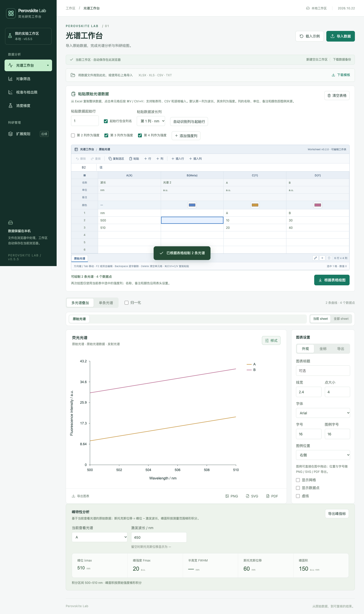
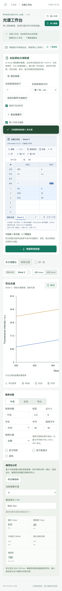

# Perovskite Lab v0.5.5（2026.10.22）

双击本目录的 `打开前端-v0.5.5-2026.10.22.command`，即可使用已构建的网页。默认地址为 http://127.0.0.1:4173/ 。如旧服务占用端口，先在旧服务终端按 Ctrl+C，再启动本版。

## 本版新增（v0.5.5）：多 Sheet 工作簿与分 Sheet 绘图

- 光谱工作台、对象筛选、校准与检出限、浓度梯度四个表格区都支持多 sheet：表格底部可「新建 sheet」「删除当前 sheet」，点标签切换，双击标签或点铅笔按钮重命名（1–40 个字符，Enter 提交、Escape 取消）。
- 每个 sheet 保存自己的一份数据，互不影响；切换 sheet 时表格、指标面板和图表一起切换并立即恢复。每个表格区最多 20 个 sheet、至少保留 1 个。
- 三个绘图页（光谱工作台、对象筛选、校准与检出限）的图表上方新增绘图 sheet 栏：「当前 sheet」只画当前 sheet；「全部 sheet」把每个 sheet 平铺成图表卡片，点卡片「查看」即可切回该 sheet。
- 新建 sheet 的初始内容贴合页面：光谱页为空表格与空图表；筛选页无对象；校准页继承当前 sheet 的响应方式、F₀、空白重复值、σ 来源与 LOD 系数等方法设置；梯度页使用默认目标浓度。
- 列头名称 / 单位 / 备注 / 颜色、表格数据、列映射按 sheet 分别保存；图表样式（坐标轴、图例位置与字号、线宽、字体、导出尺寸）在同一表格页的所有 sheet 间共用。
- 所有 sheet 列表、活动 sheet、表格内容与已绘制曲线自动保存到当前浏览器，刷新后保持原样。

详细的数据模型（active 顶层 + store 机制）、四页操作方式、限制与快捷键见 [多 Sheet 工作簿与分 Sheet 绘图](docs/多Sheet工作簿与分Sheet绘图-2026.10.22.md)。

## 同版本增强（v0.5.5）：表格键盘导航与行列插入

- **方向键导航**：点击单元格或按方向键后，活动单元格文字自动全选，直接键入即替换；键入文字后方向键仍移动单元格，不再被文字光标锁住。
- **F2 / 双击进入编辑模式**：编辑模式下方向键在文字内移动光标，Enter/Tab 确认并移动，Escape 退出编辑模式。
- **Backspace 逐字删除**：导航模式单格按 Backspace 从末尾逐字符删除，连续按逐字减少并保持导航模式；Delete 一次清空整格；多选区域 Backspace/Delete 清空整个选区。
- **任意位置插入行/列**：表格工具栏新增「插入行」「插入列」，在活动单元格上方/左侧插入空行/空列。光谱工作台插入列时会同步平移波长/强度列映射、列头元数据与列→光谱映射，重绘后曲线数量、名称与数据点不错位；插入行落在表头上方时起始行自动下移。
- **各页支持范围**：光谱工作台支持插入行+列；对象筛选、校准与检出限、浓度梯度列为固定结构，只支持插入行（插入空对象 / 空校准点 / 空目标浓度行）。
- 限制：插入行/列目前由页面直接更新数据，**不进入工作表撤销/重做历史**（单元格编辑、粘贴、删除仍可撤销）；需要回退时可在插入前使用顶部「下载数据备份」。

详细说明（两种编辑模式、Backspace/Delete 语义、插入行/列对列映射的影响、各页支持范围与快捷键）见 [表格键盘导航与行列插入](docs/表格键盘导航与行列插入-2026.10.22.md)。

## 验证（2026.10.22）

- TypeScript 检查与生产构建通过（`npm run build`，dist 已更新为 v0.5.5）。
- `npm test`：104 项单元测试通过（原有 96 项 + 本轮新增 8 项行列插入纯函数测试：表头/数据行上方插入、行列号平移、列头元数据与列→光谱键重键、边界与不修改入参）。
- `npm run test:browser`：61 项浏览器测试通过（原有 55 项 + 本轮新增 6 项表格交互回归：方向键导航与全选键入、逐字 Backspace / Delete / 多选清空、原始光谱表任意位置插入行/列与列映射重绘、对象筛选/校准/浓度梯度插入行、390px 手机端），全量连续两轮无失败、无 flake。
- 验证截图见 [验证截图-v0.5.5-2026.10.22](验证截图-v0.5.5-2026.10.22/)：光谱工作台多 sheet 表格、全部 sheet 平铺绘图、对象筛选多 sheet、校准多 sheet、浓度梯度多 sheet、390px 手机端，以及本轮新增的任意位置插入列后的光谱表、逐字删除与方向键导航、四页面插入行。




## 兼容与迁移

- 旧工作区（v0.4.5 及更早）自动升级：每个表格区生成一个 sheet，并沿用旧版本保存的标签名；无需手动导入或重新绘图。
- 已绘制的光谱曲线及其与原始光谱列的对应关系、列头元数据、对象筛选数据、校准数据、浓度梯度配方与全部样式设置都继续保留。
- 旧版未把粘贴表格草稿写入浏览器存储，因此升级后各原始光谱表显示默认空格子；已绘制的曲线不受影响，可继续在表格中粘贴新数据绘图。
- 旧工作区中的 `μM`、`µM`、`mM`、`nM` 等单位写法照常自动规范化；浏览器存储键 `perovskite-lab-workspace-v1` 不变。本轮表格交互增强不改变存储结构，旧工作区无需额外迁移。
- 恢复原工作区需要使用同一浏览器、同一地址及端口。测试预览使用 5173，启动文件使用 4173，两者的浏览器存储独立。
- 当前版本以 package.json 和 src/version-v0.5.5-2026.10.22.ts 为准；其他带旧版本或日期的组件、说明与测试为沿用文件。

<div style="display:flex;gap:12px;flex-wrap:wrap">
  
  
</div>

## 沿用 v0.4.5：导出渲染修复

- 修复首次导出 PNG 时图表标题、中文图例等文字丢失的问题（导出前预热字体并等待一次绘制再栅格化）。
- 修复 PDF 中每行图例带彩色边框的问题（PDF 转换跳过无填充的命中矩形）。
- 新增导出渲染回归测试，详见 [导出显示修复记录](导出显示修复记录-v0.4.5-2026.10.22.md)。

## 沿用 v0.4.4 / v0.4.3

- 图例可自由拖动、支持独立图例字号，位置与字号随 SVG / PNG / PDF 导出。
- 原始光谱表头（名称 / 单位 / 备注 / 颜色）同时控制图例、颜色与显隐；峰特性分析提供峰位、峰强度、半高宽、斯托克斯位移和峰面积并可导出。
- 详见 [峰特性分析与原始光谱表头同步](docs/峰特性分析与表头同步-2026.10.22.md) 与 [图例自由拖动与字号](docs/图例自由拖动-2026.10.22.md)。

## 开发

GitHub 源码不包含 dist 和 node_modules。从仓库克隆后，先安装依赖并运行构建，再使用启动文件。

```sh
npm install
npm test
npm run build
npm run dev
```

浏览器检查使用 `npm run test:browser`，默认连接 http://127.0.0.1:5173/ 。
