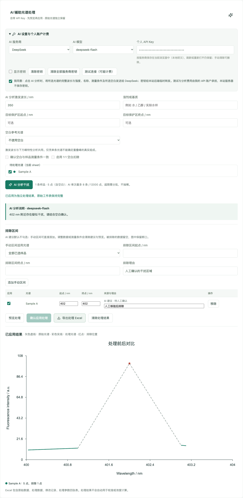

# Perovskite Lab v0.7.0

荧光研究工作台 · AI 辅助光谱处理 · 用户提供 API Key

版本日期：2026.10.24　｜　开发分支：`develop/v0.7.0`

Perovskite Lab 将原始光谱、科研绘图、对象筛选、校准与检出限、浓度梯度计算整合在同一个网页中。v0.7.0 新增 AI 辅助干扰分析：用户填写自己的模型 API Key，获得待确认的干扰区间建议，预览处理后导出可追溯的 Excel。

## v0.7.0 更新

### AI 辅助光谱处理

- 支持 DeepSeek 和 OpenAI，分别选择模型、填写个人 API Key、测试连接和请求分析。
- 结合激发波长、溶剂/基质、目标保护区和可选空白光谱，返回疑似干扰区间与判断说明。
- AI 建议默认不勾选，用户核验后决定是否排除；支持修改区间、填写理由和手动添加干扰区域。
- 处理前后叠图显示原始曲线、处理曲线和排除位置；按“预览处理 → 确认应用 → 导出”完成操作。
- 支持 1:1 空白扣除。波长不一致时，仅在空白实测范围内线性插值，保留扣除后的负值。
- 原始光谱独立保留，处理结果作为独立快照。排除区间留空，绘图保留断口。

### API Key 按服务商保存

- 密钥和模型按服务商分别保存在当前浏览器，刷新、关闭后重新打开、切换服务商时可恢复。
- 支持清除当前服务商密钥或全部密钥，并同步到其他同源标签页。
- 模型费用由个人 API 账户承担。密钥仅在请求时经本站后端临时转发，服务器不持久保存。
- 工作区备份和 Excel 导出均不包含 API Key。

### 可追溯 Excel 导出

| 工作表 | 内容 |
| --- | --- |
| 原始数据 | 样品与所选空白的波长、原始强度和来源 |
| 处理数据 | 原始强度、空白强度、处理强度、排除状态和理由 |
| 修改记录 | 区间边界、适用光谱、建议来源和应用状态 |
| 处理参数 | 测量条件、保护区、扣除方法、模型、分析说明及软件版本 |

导出文件自动包含版本与北京时间日期，例如 `光谱干扰处理-v0.7.0-2026.10.24.xlsx`。

## 现有工作台

| 页面 | 主要功能 |
| --- | --- |
| 光谱工作台 | TXT/CSV/TSV/Excel 导入、表格粘贴、多光谱叠加、归一化、峰特性分析、AI 辅助处理 |
| 对象筛选 | 自定义分析对象、空白参考、响应计算与比较绘图 |
| 校准与检出限 | 校准曲线、拟合范围选择、空白标准差、LOD/LOQ 计算 |
| 浓度梯度 | 独立母液/目标单位、配液计算与 Excel 导出 |

继续支持多 sheet、列头名称/单位/备注/颜色编辑、单元格编辑与撤销、行列插入、四侧坐标轴、独立图表标题、数据点数值标注，以及 SVG/PNG/PDF 图表导出。

## 安装与启动

需要 Node.js 20.19+ 或 22.12+。从源码下载后，先在项目目录安装依赖：

```sh
npm install
```

**macOS：**双击 [打开前端-v0.7.0-2026.10.24.command](打开前端-v0.7.0-2026.10.24.command)。脚本会先构建，再启动网页与 AI 转发接口，默认地址为 `http://127.0.0.1:4173/`。使用期间保留终端窗口，结束时按 Ctrl+C。

**Windows / Linux / macOS 命令行：**

```sh
npm run build
npm run preview -- --host 127.0.0.1 --port 4173 --strictPort
```

然后在浏览器访问 `http://127.0.0.1:4173/`。端口被占用时，先停止旧服务；沿用同一浏览器和地址可读取原工作区及已保存的密钥。

开发调试使用 `npm run dev`，默认地址为 `http://127.0.0.1:5173/`。5173 与 4173 的浏览器存储独立。

## AI 处理步骤

1. 导入 TXT 或其他支持的文件，确认起始行、波长列和强度列。也可粘贴数据后点击“根据表格绘图”。
2. 在“AI 辅助光谱处理”选择服务商和模型，填写个人 API Key；后续打开同一网址时自动读取。
3. 填写激发波长、溶剂或基质，按需设置目标保护区、选择空白并确认测量条件一致。
4. 选择待处理样品，确认数据发送与个人账户计费说明，点击“AI 分析干扰”。
5. 核验分析说明和建议区间，勾选需要排除的区域，或手动补充区间。
6. 预览并确认处理结果，导出四表 Excel。手动排除与空白扣除也可独立使用。

AI 单次最多分析 8 条样品、12000 个数据点（含空白），超限提示分批；程序保留完整测量点，不自动抽稀。变更数据或测量条件后，旧建议清除；修改区间后，需要重新预览与确认。

## 数据与密钥

工作区保存在当前浏览器，原存储键 `perovskite-lab-workspace-v1` 保持不变。API Key 使用独立的本地存储记录，按服务商保存；本地为明文，本站页面脚本可以读取。清除网站数据、浏览器清理或无痕会话结束可能删除保存内容。

只有用户点击测试或分析才调用模型。分析请求将所选光谱的完整波长/强度、名称及测量条件，经本站接口发送给选定的 AI 服务商；测试连接只发送最小测试提示。测试与分析按服务商规则计费，Cloudflare 转发另有基础设施用量。

处理建议与处理结果保留在当前面板内存中，请及时导出；刷新页面后需重新处理。目标峰与干扰峰重叠时，需要空白或其他测量证据支持判断。处理结果当前作为独立导出数据，不自动更新校准或浓度计算。

## 开发与部署

```sh
npm test
npm run build
npm run dev
```

浏览器测试默认连接 5173，可在服务启动后运行 `npm run test:browser`。macOS 测试配置使用本机 Google Chrome。

Vite 开发和 preview 服务均提供 `/api/ai/test` 与 `/api/ai/analyze`。Cloudflare 部署需要同时包含 Worker 与静态资源，配置见 `wrangler.jsonc`；仅上传 `dist` 或使用旧 Python 静态服务器无法提供 AI 转发接口。用户自带密钥模式无需配置开发者模型密钥。

当前版本入口为 `package.json` 和 `src/version-v0.7.0-2026.10.24.ts`。沿用文件名中的旧版本号表示该组件或文档的来源。

## 验证记录（2026.10.24）

- v0.7.0 TypeScript 检查与生产构建通过。
- 132 项单元测试通过，覆盖原有计算、工作簿、导入、AI 接口校验、光谱处理和 Excel 内容。
- 本次版本整理未执行浏览器回归，Chrome 启动请求未获授权。此前密钥持久化改动已通过 18 项浏览器回归；v0.7.0 的浏览器用例已同步版本断言与截图保存位置，待运行 `npm run test:browser` 验证。
- 验证使用模拟 API 和虚构密钥；真实模型的鉴权、网络和光谱判断准确度由用户结合自己的 API 账户与实验数据核验。

## 文档与界面

- [v0.7.0 发行版简介](RELEASE-v0.7.0-2026.10.24.md)
- [AI 自带密钥与光谱处理说明](docs/AI自带密钥与光谱处理-2026.10.24.md)
- [多 sheet 工作簿与绘图](docs/多Sheet工作簿与分Sheet绘图-2026.10.22.md)
- [表格编辑与行列插入](docs/表格键盘导航与行列插入-2026.10.22.md)


