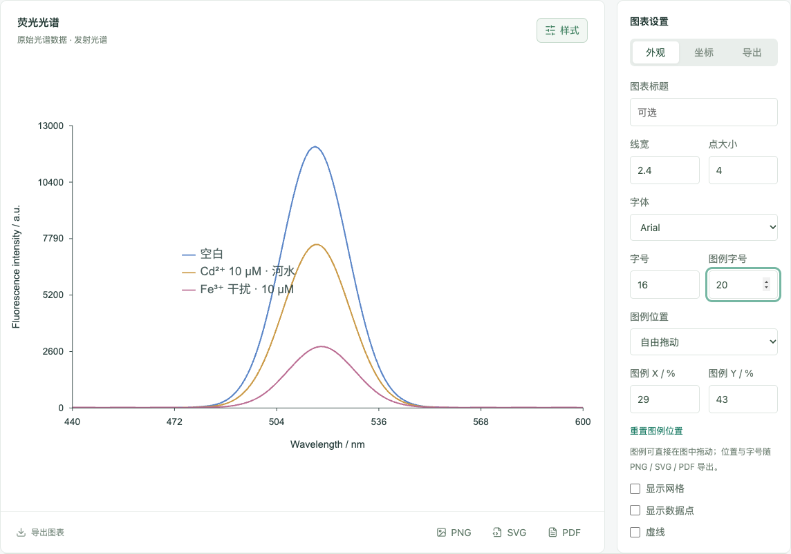

# 图例自由拖动与字号（v0.4.4，2026.10.22）

## 适用页面

光谱工作台、对象筛选、校准与检出限三个绘图区共用同一套图例设置。筛选图默认不显示图例，可在「图例位置」中选择「自由拖动」后显示并可移动。

## 操作方式

- **直接拖动**：在图中按住图例任意一行拖动，图例即切换为自由位置。拖动透明命中区覆盖整行文字，不必精确按住文字。
- **精确输入**：选择「自由拖动」后，可在右侧「图例 X / %」「图例 Y / %」输入相对画布的位置；位置会自动限制在画布内。
- **图例字号**：独立于坐标字号。未单独设置时跟随坐标字号；设置后只改变图例文字大小。
- **重置**：点击「重置图例位置」恢复右侧（筛选图为隐藏）。
- **预设位置**：右侧、底部、隐藏仍保留，切换后仍可直接拖动，自动转为自由位置。

## 导出

自由位置与图例字号随图表样式保存到本地工作区，并原样用于 SVG、PNG、PDF 导出。图例分组带有 `data-legend`、`data-legend-x`、`data-legend-y` 属性，便于后续自动排版或测试读取。

## 实现说明

- `ChartStyle` 新增 `legendX`、`legendY`（画布宽高的 0–1 比例）和 `legendFontSize`；`legend` 增加 `free` 取值。
- 图例渲染在 `src/domain/chart.ts`，绘制透明命中矩形，保证拖动不会只命中文字笔画。
- 拖动逻辑在 `src/components/ChartPanel.tsx`，使用 Pointer Events 与指针捕获；指针释放时把实际绘制位置回写到样式，避免存储位置与画布内位置不一致。
- 柱子图（对象筛选）启用图例时使用色块标记，不画线标记。

## 验证

`pnpm test`：66 项单元测试通过。`pnpm test:browser`：47 项浏览器测试通过；新增用例覆盖三个绘图区的拖动、图例字号、位置持久化、刷新恢复、预设切换与越界输入限制。

## 预览

