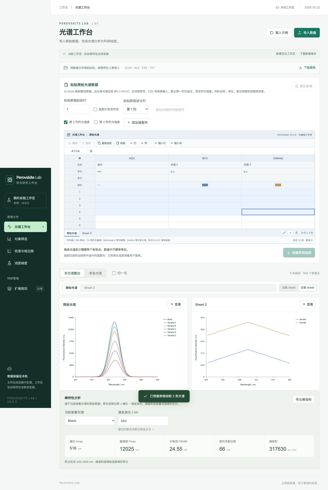
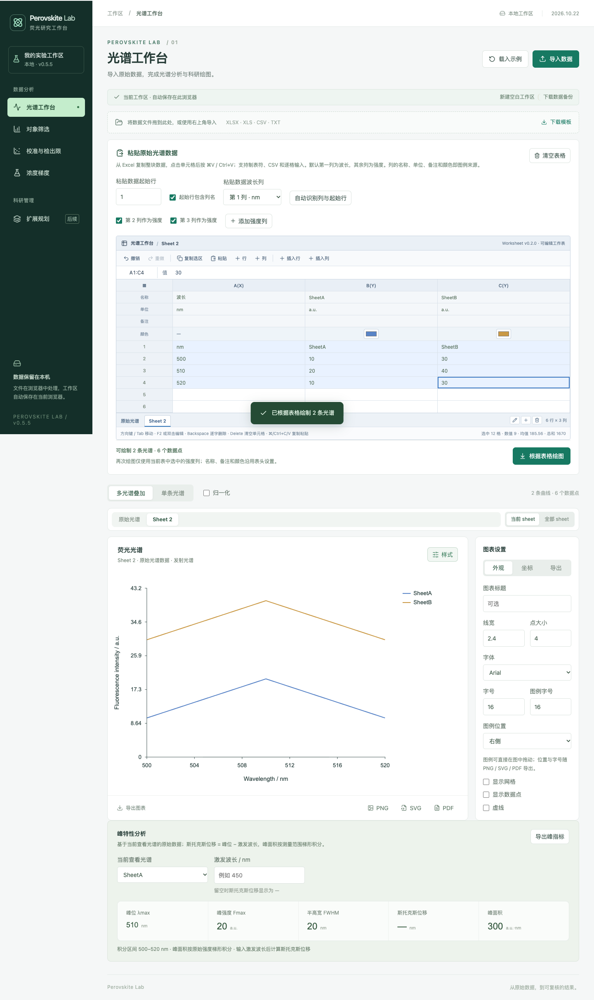

# 多 Sheet 工作簿与分 Sheet 绘图（v0.5.5，2026.10.22）

## 适用范围

光谱工作台、对象筛选、校准与检出限、浓度梯度四个表格区都使用同一套多 sheet 工作簿模型：每个表格区可以建立多个 sheet，每个 sheet 保存自己的一份数据；切换 sheet 时工作表、指标与图表一起切换。三个绘图页（光谱工作台、对象筛选、校准与检出限）的图表区还提供「当前 sheet / 全部 sheet」两种视图。

## 数据模型：active 在顶层，其余在 store

工作区（浏览器 localStorage 键 `perovskite-lab-workspace-v1`）新增 `workbooks` 字段，四个表格区各一个工作簿：

```ts
interface WorkbookState {
  tabs: { id: string; name: string }[];   // sheet 标签，顺序即界面顺序
  activeId: string;                        // 当前活动 sheet 的 id
  store: Record<string, SheetPayload>;     // 非活动 sheet 的数据
}
```

核心约定只有一条：**活动 sheet 的数据放在工作区顶层字段里，非活动 sheet 的数据放在 `store` 里。**

| 表格区 | 顶层字段（活动 sheet） | store 中的对应 payload |
|---|---|---|
| 光谱工作台 | `rawSheet`（grid + mapping）、`spectra`、`rawSpectra`、`rawColumnSpectra`、`excitation` | `RawSheetPayload` |
| 对象筛选 | `objects`、`blankId`、`screenMode` | `ScreeningSheetPayload` |
| 校准与检出限 | `calibration`、`calMode`、`calUnit`、`calF0`、`blankRepeats`、`manualSigma`、`sigmaSource`、`lodFactor`、`fitMin`、`fitMax` | `CalibrationSheetPayload` |
| 浓度梯度 | `gradient`（母液/体积/固定添加/目标浓度/单位） | `GradientSheetPayload` |

这样原有的页面组件继续读取原来的顶层字段即可，多 sheet 不影响既有逻辑：

- `capturePayload(w, page)`：把当前顶层字段读成一个 payload；
- `applyPayload(w, page, payload)`：把某个 payload 写回顶层字段；
- `switchSheet(w, page, targetId)`：先把活动 payload 收进 `store[旧 activeId]`，再从 `store` 取出目标 payload、写回顶层字段，然后把 `activeId` 指向目标 sheet；
- `ensureWorkbooks(w)`：载入和每次 `update` 后都会执行，负责修复结构（见下）。

实现位置：数据模型与全部纯函数在 `src/domain/workbook.ts`，React 侧封装在 `src/state/useWorkbook.ts`。

### ensureWorkbooks 修复与迁移

每次载入工作区和每次修改后都会运行 `ensureWorkbooks`，保证不变量：

- 四个表格区都至少有一个 sheet；
- `activeId` 一定指向存在的 tab，非法时回退到第一个 sheet；
- 活动 sheet 的 payload 不会残留在 `store` 中（避免出现两份不一致的数据）；
- 非活动 tab 缺失 payload 时补该表格区的默认空 payload；
- 非法的 tab 记录（缺少 id、重复 id）丢弃，空名称或超过 40 字符的名称回退为默认名，重名自动追加 `(2)`、`(3)`；
- 每个表格区最多 20 个 tab，超出的持久化数据会被截断；
- 旧工作区（v0.4.5 及更早，没有 `workbooks`/`rawSheet`）自动升级：每个表格区生成单 sheet，沿用旧 `sheetNames` 中的标签名；原始光谱草稿补默认空格子；`μmol/L`、`mM`、`nM` 等旧单位写法照常规范化。

## 四个页面的使用方式

### 表格区按钮

每个表格底部都有一排 sheet 操作（`.worksheet-bottom`）：

| 控件 | 可访问名称 / 操作 | 说明 |
|---|---|---|
| sheet 标签 | 标签文字即 sheet 名，活动标签 `aria-pressed=true` | 点击切换；双击活动标签也可进入重命名 |
| 重命名 | `重命名标签 ${当前 sheet 名}` | 标签名 1–40 字符；Enter 或失焦提交，Escape 取消，空白名会被拒绝 |
| 新建 sheet | `新建 sheet` | 追加 `Sheet 2`、`Sheet 3`… 并立即激活；新建后工作区显示该 sheet 的默认空数据 |
| 删除当前 sheet | `删除当前 sheet` | 立即删除活动 sheet（无确认弹窗）；至少保留 1 个 sheet，最后一个时按钮禁用；删除后右邻居优先、否则左邻居激活 |

新建 sheet 的初始内容按页面而定：

- **光谱工作台**：空表格（6 行 × 3 列默认网格）+ 空图表；
- **对象筛选**：无对象，图表为空；
- **校准与检出限**：无数据点，但继承当前 sheet 的响应方式、固定参考 F₀、空白重复值、σ 来源、LOD 系数等分析方法设置（拟合范围清空），便于直接沿用同一套方法；
- **浓度梯度**：使用默认目标浓度（`0, 0.1, 0.5, 1, 2, 5, 10`），可单独修改。

### 绘图区：当前 sheet / 全部 sheet

三个绘图页在图表上方增加了绘图 sheet 栏（`.plot-sheet-bar`）：

- 左侧是绘图 sheet 标签，可访问名称 `绘图 sheet ${sheet 名}`，与表格区的活动 sheet 同步；
- 右侧是视图切换：「当前 sheet」（默认）只画当前 sheet；「全部 sheet」把该表格区的每个 sheet 平铺成一张卡片（`.sheet-gallery-card`），卡片头部是 sheet 名，卡片内用该 sheet 自己的数据和列头元数据绘图，样式与当前页共享；从 v0.6.0 起每张图表可使用各自 sheet 独立的标题（标题中不追加 sheet 名，见[表格拖拽框选与图表标题数值](表格拖拽框选与图表标题数值-2026.10.23.md)）；
- 卡片右上角「查看」按钮（`查看 sheet ${sheet 名}`）会把该 sheet 切为当前 sheet，并回到「当前 sheet」视图。

切回旧 sheet 时，表格内容、指标面板和图表一起恢复；不同 sheet 的数据互不影响。浓度梯度页没有绘图区，因此没有这套切换。

### 数据归属与样式共用

- **按 sheet 保存**：表格数据、原始光谱列映射、列头名称 / 单位 / 备注 / 颜色（`sheetMetadata` 以 sheet id 为键）、校准方法设置、梯度配方、图表标题（`WorkbookTab.chartTitle`，留空时使用页面默认标题）；
- **页面内共用**：图表样式（坐标轴、图例位置与字号、线宽、字体、导出尺寸等 `styles`）在同一表格页的所有 sheet 间共用，切换 sheet 不改变样式设置；图表标题自 v0.6.0 起按 sheet 独立，不属于共用样式；
- 删除 sheet 时，该 sheet 的列头元数据一起清理。

## 限制与注意事项

- 每个表格区最多 **20 个 sheet**；达到上限后「新建 sheet」不再新增（表格区会提示）。
- 每个表格区至少保留 1 个 sheet。
- sheet 名称为 1–40 个字符；与其他 sheet 重名时自动追加序号（如 `梯度配液 (2)`），保证标签可区分。
- sheet 的删除没有确认弹窗，也不进入工作表编辑的撤销/重做历史；删除前可用页面顶部「下载数据备份」导出工作区 JSON。
- 工作区仍使用原存储键，保存在当前浏览器、当前地址与端口下；5173（开发预览）与 4173（启动文件）的浏览器存储互相独立。

## 操作示例（光谱工作台）

1. 打开光谱工作台，默认只有一个「原始光谱」sheet，显示 6 条示例曲线。
2. 点击表格底部「新建 sheet」，出现并激活「Sheet 2」，图表区变为空状态。
3. 在「粘贴原始光谱数据」表中粘贴两列强度数据，点击「根据表格绘图」，图表画出 Sheet 2 的曲线。
4. 点击绘图 sheet 栏的「原始光谱」，示例曲线恢复；点击「全部 sheet」可同时查看两个 sheet 的图表，点卡片「查看」回到单个 sheet。
5. 点击「重命名标签 Sheet 2」改为「实验组 A」，刷新页面后 sheet 列表、表格单元格和曲线都保持原样。

## 快捷键

工作表的键盘操作与 v0.4.x 相同：

- 拖动或 Shift + 点击选择区域；Tab / 方向键移动活动单元格；
- F2 进入编辑；Enter 确认、Escape 取消；
- ⌘/Ctrl + C / V 复制粘贴矩形区域；
- 双击活动 sheet 标签进入重命名，Enter 提交、Escape 取消。

## 实现与测试位置

- 数据模型：`src/domain/workbook.ts`（`ensureWorkbooks`、`capturePayload`、`applyPayload`、`switchSheet`、`createSheet`、`renameSheet`、`deleteSheet`、`sheetSnapshots`、`MAX_SHEETS`）；
- 状态封装：`src/state/useWorkbook.ts`；工作区载入迁移：`src/state/workspace.tsx`；
- 绘图区组件：`src/components/SheetPlotPanel-v0.5.5-2026.10.22.tsx`（`PlotSheetBar`、`SheetChartGallery`）；
- 表格区多 sheet 标签：`src/components/Worksheet-v0.2.0-2026.10.19.tsx`；
- 单元测试：`tests/workbook-v0.5.5-2026.10.22.test.ts`（30 项）；
- 浏览器回归：`tests/browser/workbook-sheets-v0.5.5.spec.ts`（5 项，覆盖四个页面、刷新持久化与 390px 手机端）。

## 验证

`npm test`：96 项单元测试通过。`npm run test:browser`：55 项浏览器测试通过（原有 50 项 + 新增多 sheet 5 项）。`npm run build` 通过。验证截图见 [验证截图-v0.5.5-2026.10.22](../验证截图-v0.5.5-2026.10.22/)。

## 预览




