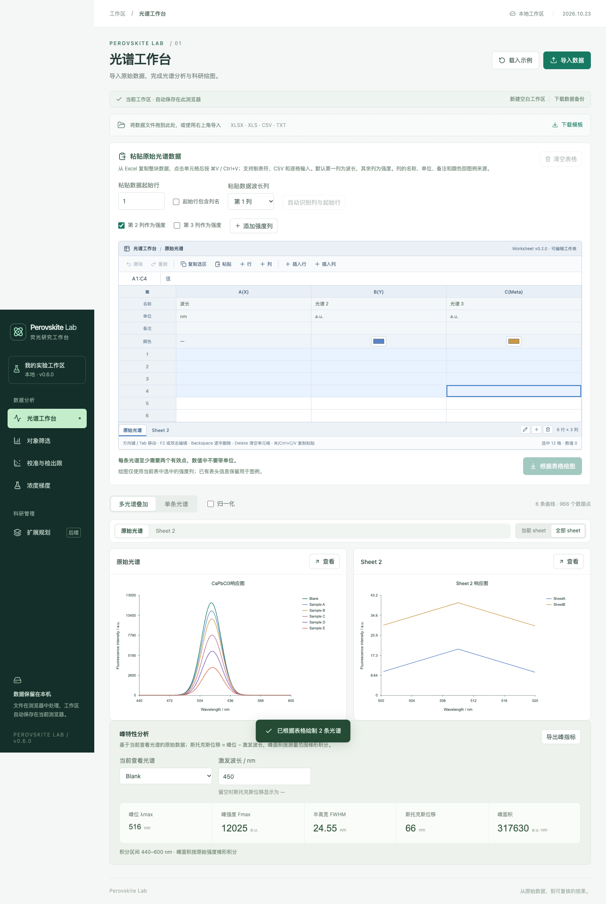
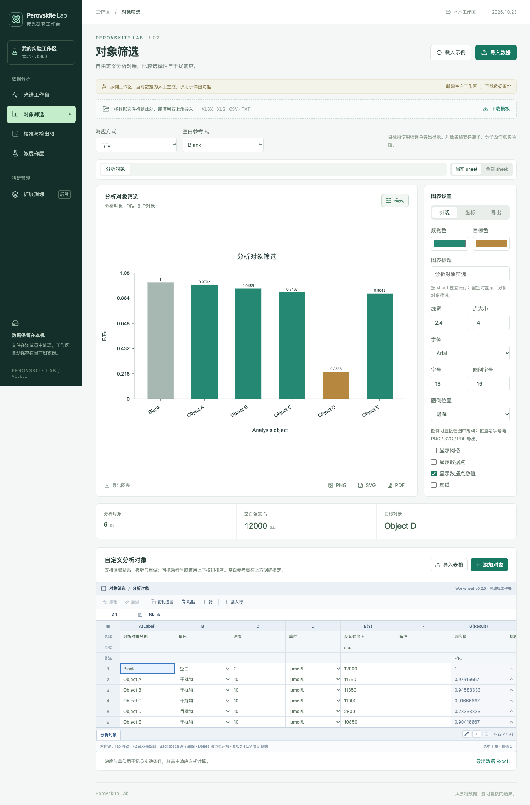
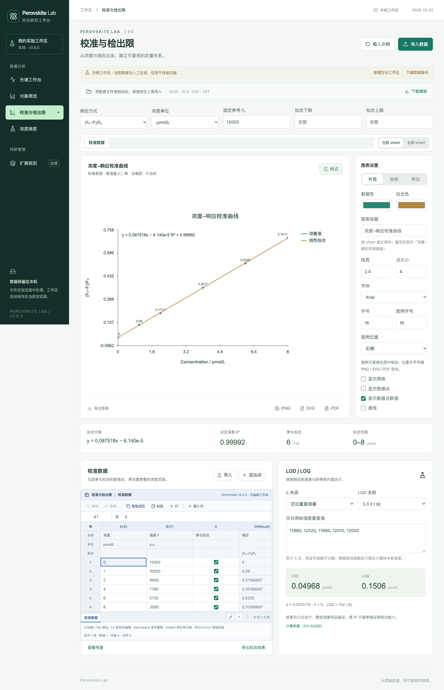
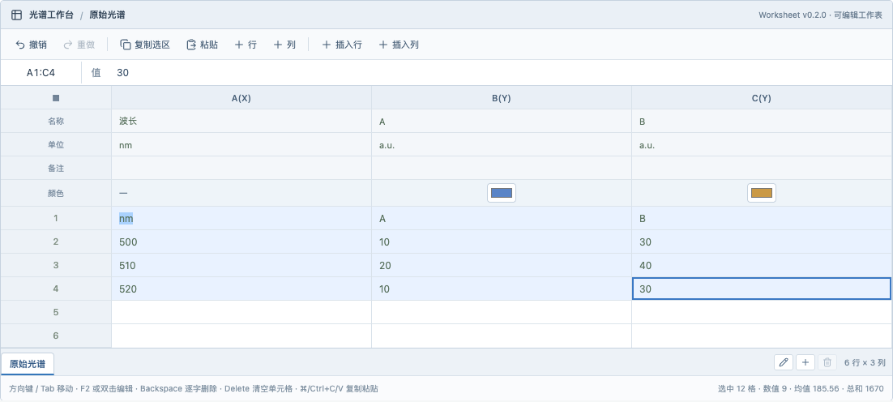

# 表格拖拽框选、每 sheet 图表标题与数据点数值（v0.6.0，2026.10.23）

本轮包含两项表格拖拽选中修复、每 sheet 独立图表标题，以及可选的图中数据点数值标注（4 个需求点）。

## 1. Windows 下输入数据后不能拖动选中表格

### 现象

在 Windows 的 Chrome / Edge 中，先点击单元格输入数据，再从该单元格按下鼠标拖动时，表格不会出现蓝色选区，只有当前单元格被选中；同一操作在 macOS 上正常。

### 原因

单元格由铺满整格的 `<input>` 渲染。点击单元格后输入框获得焦点并全选文字；此时在输入框内按下鼠标拖动，Windows 浏览器会把这当成「拖动选中的文本」，启动浏览器原生拖放（`dragstart` 后紧跟 `pointercancel`）。原生拖放开始后指针事件流被取消，依赖 `pointerenter` 更新选区焦点的拖拽框选就失效了。

### 修复

采用多层防御，全部在共享工作表组件中完成，四个表格页同时生效：

1. **取消单元格的默认按下行为**：在 `td` 的 `pointerdown` 中对文本/数字输入与只读单元格调用 `e.preventDefault()`，浏览器不再启动文本选择或原生拖放；随后通过现有 `pendingFocus` + `useLayoutEffect` 手动聚焦输入框并全选文字，保持「点击后全选、直接键入替换」的原行为。
2. **禁止输入框成为拖放源**：单元格 `input` 设置 `draggable={false}`，样式补 `-webkit-user-drag: none`；工作表根节点拦截来自 `[data-cell]` 的 `dragstart`。
3. **不改原生控件行为**：`select` / `checkbox` / `color` 以及 `renderCell` 自定义内容（行内删除、排序按钮）不拦截默认行为，下拉、勾选、按钮点击与行号拖动排序保持原样。
4. **窗口级指针兜底**：拖拽期间在 `window.pointermove` 中用 `document.elementFromPoint` 命中当前工作表内的 `[data-cell]` 扩展选区，即使快速拖动、指针短暂离开表格再回来也能选中完整矩形；`pointerup` / `pointercancel` 清理拖拽状态与指针 id。

## 2. Windows 版本不能快速选中表格

与第 1 点同源：快速拖动时浏览器可能跳过中间的 `pointerenter`，或被原生拖放取消指针流。修复后：

- 一次 `pointermove` 直接跨多格（Playwright 中 `steps: 1`）仍能选中包含起点与终点的完整矩形；
- 指针离开表格再移回时，选区从最后一个有效单元格继续扩展；
- Shift+点击、Shift+方向键、⌘/Ctrl+A 全选等既有选择方式不变。

限制：Windows 真机上的浏览器原生拖放无法在 macOS CI 上复现，自动化测试验证的是上述机制（`dragstart` 被阻止、快速/越界拖动选区正确），发布前仍建议在 Windows Chrome / Edge 手工回归一次。

## 3. 每个 sheet 的图表标题独立

### 设计

- 图表设置中的「图表标题」**按 sheet 独立保存**（`workbooks[page].tabs[].chartTitle`），不是页面级共享设置：在某个 sheet 上输入标题只影响该 sheet，其他 sheet 的标题保持不变。
- 图表标题**不追加 sheet 名**。例如标题输入 `CsPbCl3响应图`，图表头部、图内 SVG 标题与 PNG / SVG / PDF 导出都只显示 `CsPbCl3响应图`，不会出现 `CsPbCl3响应图 · 原始光谱`。
- 标题留空时使用页面默认标题：光谱工作台 `荧光光谱`、对象筛选 `分析对象筛选`、校准与检出限 `浓度–响应校准曲线`。
- 新建 sheet 从页面默认标题开始，不继承其他 sheet 的自定义标题；重命名 sheet 不改变任何图表标题；切换 sheet 时标题随该 sheet 恢复。
- 标题随工作区持久化，刷新后保持；「全部 sheet」画廊里每张图表卡片使用各自 sheet 的标题（卡片标题仍显示 sheet 名，便于区分数据）。

### 旧工作区迁移

v0.5.5 及更早版本的图表标题是页面共享的 `styles[kind].title`。升级时会把该标题一次性写入对应绘图页每个 sheet 的 `chartTitle`，然后清空旧字段；因此升级前的自定义标题（例如此前填写的 `CsPbCl3响应图`）在升级后每个 sheet 都是同样的初始标题，之后可分别修改。旧版默认英文标题（`Selectivity`、`Calibration`）也会按同样方式迁移。

## 4. 新功能：在图中显示数据点数值

- 三个绘图页的「图表设置 → 外观」新增复选框 **显示数据点数值**（图表设置默认展开）。勾选后当前图表立即在每个数据点旁显示对应的 y 值。
- 折线/散点：数值显示在数据点旁，优先放上方；贴近绘图区顶部时自动改放下方，并在左右边缘调整对齐方式，避免超出绘图区。
- 柱状图：数值显示在柱顶上方；负值显示在柱底下方。
- 校准曲线只标注「测量值」数据点，不标注「线性拟合」线的端点（拟合线是派生结果，不是测量点）。
- 数值字号约为图表字号的 0.75 倍（最小 9），沿用图表前景色；随 SVG / PNG / PDF 导出，不进入图例或坐标轴文本。
- 勾选状态与其他图表样式一起保存在工作区（`w.styles[kind].pointValues`），切 sheet、切页面、刷新后保持；旧工作区默认关闭。
- 数据点很多时（例如 161 点的原始光谱）数值会密集重叠，属于用户主动开启的可读性取舍；单条光谱或筛选/校准图效果更清晰。

## 实现与测试位置

- 拖拽框选：`src/components/Worksheet-v0.2.0-2026.10.19.tsx`、`Worksheet-v0.2.0-2026.10.19.css`；
- 每 sheet 图表标题存储：`src/domain/workbook.ts`（`sheetChartTitle`、`setActiveSheetChartTitle`、`seedSheetChartTitles`、`WorkbookTab.chartTitle`）；旧共享标题迁移：`src/state/workspace.tsx`（`migrateSheetChartTitles`）；
- 数据点数值渲染：`src/domain/chart.ts`（`chartSVG`）；
- 样式字段：`src/domain/types.ts`（`ChartStyle.pointValues`、`Series.showPointValues`、`WorkbookTab.chartTitle`）；
- 图表面板：`src/components/ChartPanel.tsx`（标题输入按当前 sheet 读写）；画廊：`src/components/SheetPlotPanel-v0.5.5-2026.10.22.tsx`；
- 三个绘图页接线：`src/features/Spectra.tsx`、`Screening.tsx`、`Calibration.tsx`；
- 单元测试：`tests/chart-values-and-titles-v0.6.0.test.ts`（12 项，含每 sheet 标题独立保存、回退与旧标题迁移）；
- 浏览器回归：`tests/browser/table-selection-v0.6.0.spec.ts`（5 项）、`tests/browser/chart-values-titles-v0.6.0.spec.ts`（2 项）、`tests/browser/release-v0.6.0-2026.10.23.spec.ts`（4 项，含发布截图）。

## 验证

`npm test`：116 项单元测试通过（原有 104 项 + 新增 12 项）。`npm run test:browser`：72 项全量通过（原有 61 项 + 新增 11 项），含表格拖拽、每 sheet 标题、数据点数值与 390px 手机端。`npm run build` 通过。验证截图见 [验证截图-v0.6.0-2026.10.23](../验证截图-v0.6.0-2026.10.23/)。

## 预览

