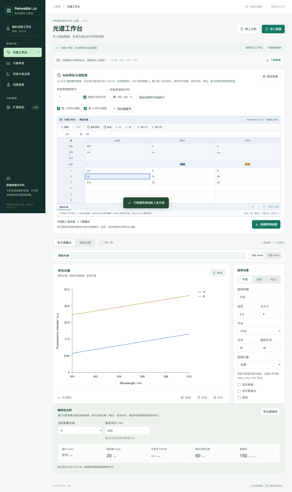

# 表格键盘导航与行列插入（v0.5.5 同版本增强，2026.10.22）

## 导航模式与编辑模式

本轮把表格单元格的「选择」和「编辑」明确分成两种模式，避免输入时光标被文字锁住。

| 模式 | 如何进入 | 按键行为 |
|---|---|---|
| **导航模式**（默认） | 点击单元格、方向键/Tab 移动后 | 活动单元格内文字**全选**，直接键入即整体替换；方向键 / Tab / Enter 继续移动单元格；F2 或双击进入编辑模式 |
| **编辑模式** | F2、双击单元格 | 光标进入单元格内，方向键在文字中移动光标；Enter 确认并下移到下一行，Tab 确认并移向右侧，Escape 退出编辑模式 |

- 点击活动单元格时文字自动全选，键入第一个字符即替换原内容，不会出现「内容没删掉、新字接在后面」的情况。
- 在编辑模式里修改立即写回表格（与旧版逐字编辑一致）；Escape 只是退出编辑模式，不会回滚已输入的字符。
- 双击活动 sheet 标签仍是重命名，不影响单元格编辑模式。

## Backspace / Delete 语义

| 操作 | 效果 |
|---|---|
| 单格导航模式 **Backspace** | 从末尾**逐字符删除**：第一次按键取消全选并删掉最后一个字符，连续按逐字减少；删空后仍保持导航模式，方向键继续移动单元格 |
| 单格 **Delete** | 一次清空整格 |
| 多选区域 **Backspace / Delete** | 清空整个选区（与 Excel 一致） |
| 编辑模式内的 Backspace / Delete | 按文本光标常规删除（前删 / 后删一个字符） |

## 任意位置插入行 / 列

表格工具栏（`.worksheet-tools`）新增两个按钮，可访问名称精确为 `插入行`、`插入列`：

- **插入行**：在活动单元格所在行**上方**插入一整行空行，原数据整体下移；插入后活动单元格保持原坐标，正好落在新空行上，可直接输入。
- **插入列**：在活动单元格所在列**左侧**插入一整列空列，原数据整体右移，活动单元格同样落在新空列上。
- 插入不会改动其他 sheet；切 sheet、刷新页面后新行/列保留。

### 原始光谱表：插入列会同步平移列映射

原始光谱表的绘图依赖列号（波长列、强度列、列头元数据、列→光谱映射），插入列时这些信息会一起右移，保证曲线仍对应原数据：

- 波长列 `mapping.x` 与强度列 `mapping.ys` 中位于插入位置之后的列号 +1；
- 列头「名称 / 单位 / 备注 / 颜色」元数据（`sheetMetadata`）同步右移；
- 已绘制曲线与列的对应关系（`rawColumnSpectra` 键 `raw-1`、`raw-2`…）同步右移，并清空绘图列缓存；
- 插入列后表格中会多一列空白，此时点「根据表格绘图」重绘：已绘制的曲线数量和名称不变、数据点不会错位；不重绘时曲线也保持原样。

插入行时，如果插入位置在表头/起始行之上，标题行起始行号 `mapping.start` 自动 +1，表头仍被正确识别；插入行后直接点「根据表格绘图」即可，不会把表头误当数据。

### 固定列页面只支持插入行

| 页面 | 插入行 | 插入列 | 说明 |
|---|---|---|---|
| 光谱工作台（原始光谱表） | ✅ | ✅ | 列映射、列头元数据、列→光谱映射同步平移 |
| 对象筛选 | ✅ | — | 插入空对象行（名称自动为「对象 N」，强度留空），列为固定结构 |
| 校准与检出限 | ✅ | — | 插入空校准点（默认勾选参与拟合），列为固定结构 |
| 浓度梯度 | ✅ | — | 插入空目标浓度行；在首行插入会产生前导空行，目标浓度文本以空行开头 |

- 空白草稿行会让图表/配液表暂停计算并给出校验提示（例如「对象 7 的强度不是有效数值」「目标浓度应在 0 与母液浓度之间」），补全数值后恢复正常。
- 浓度梯度以换行保存目标浓度行（原逗号分隔会自动转成换行），因此空行会被准确保留。

## 与撤销/重做的关系（限制）

- 撤销/重做仍覆盖**单元格编辑、粘贴、删除**等经工作表 `onChange` 的数据修改。
- **插入行/列目前由页面直接更新数据，不进入工作表的撤销/重做历史**（工具栏「插入行」「插入列」按钮不产生一条可撤销记录）；如需回退，请在插入前使用页面顶部「下载数据备份」导出工作区 JSON，或使用浏览器刷新后重新载入备份的流程。
- sheet 的新建/重命名/删除同样不进入工作表的撤销历史（见多 sheet 文档）。

## 快捷键汇总

- 方向键 / Home / End：移动活动单元格；⌘/Ctrl + Home / End：跳到首/末行首/末列；
- Tab / Shift+Tab：左/右移动；Enter / Shift+Enter：下/上移动；
- F2 或双击：进入编辑模式；Escape：退出编辑模式 / 取消选区扩展；
- ⌘/Ctrl + Z / Y：撤销 / 重做；⌘/Ctrl + A：全选工作表；⌘/Ctrl + C / V：复制 / 粘贴；
- 导航模式 Backspace 逐字删除、Delete 清空整格；多选后 Backspace / Delete 清空选区。

## 实现与测试位置

- 行列插入纯函数：`src/domain/raw-sheet-edit.ts`（`insertRawSheetRow`、`insertRawSheetColumn`）；
- 键盘导航 / 逐字删除 / 插入按钮：`src/components/Worksheet-v0.2.0-2026.10.19.tsx`；
- 原始光谱表接线（映射/元数据/列→光谱重键）：`src/components/PasteSpectraTable-2026.10.18.tsx`；
- 对象筛选 / 校准 / 浓度梯度的插入行：`src/features/Screening.tsx`、`src/features/Calibration.tsx`、`src/features/Gradient.tsx`；
- 单元测试：`tests/raw-sheet-edit-v0.5.5.test.ts`（8 项）；
- 浏览器回归：`tests/browser/worksheet-editing-v0.5.5.spec.ts`（6 项，覆盖导航/全选键入/逐字删除/Delete/多选清空、原始光谱表插入行列与列映射重绘、三个固定列页面插入行、390px 手机端）。

## 验证

`npm test`：104 项单元测试通过（原有 96 项 + 新增 8 项行列插入纯函数测试）。`npm run test:browser`：61 项浏览器测试通过（原有 55 项 + 新增 6 项表格交互回归，两轮全量无 flake）。`npm run build` 通过。验证截图见 [验证截图-v0.5.5-2026.10.22](../验证截图-v0.5.5-2026.10.22/)。

## 预览

