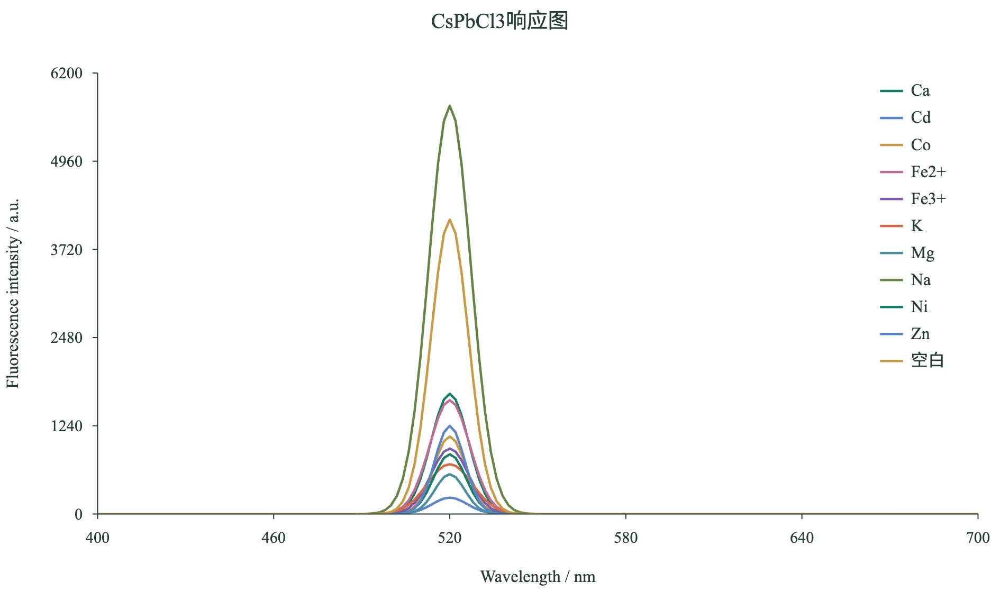
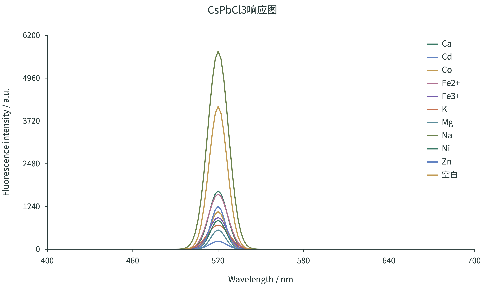

# 导出显示修复记录（v0.4.5，2026.10.22）

基础提交：3221306（v0.4.4）。修复版本：v0.4.5。

## 现象

用户反馈 v0.4.4 导出的两个显示错误：

1. **PNG 不显示图标题**：`荧光光谱-v0.4.4-2026.10.22.png` 顶部没有「CsPbCl3响应图」标题；同一图表导出的 PDF 标题正常。首次导出时还可能一并缺少中文图例文字，第二次导出又恢复正常。
2. **PDF 图例有边框**：`荧光光谱-v0.4.4-2026.10.22.pdf` 中每行图例文字外都套着一个与曲线同色的边框（macOS 预览 / PDFKit 渲染可见），PNG 与网页中没有这个边框。

## 原因

### PNG 丢标题

PNG 导出把图表 SVG 序列化成 `` 再绘制到 canvas。为避免中文在其它电脑上变成方框，导出用 SVG 内嵌了 data-URI 的 woff 字体（约 6 MB）。Chromium 对通过 `` 加载的 SVG 会先按资源加载时序栅格化一帧，`img.onload` 触发时内嵌字体常常尚未加载完成，于是首次 `drawImage` 抓到的是缺字的第一帧：标题、中文图例等依赖内嵌字体的文字为空。页面内后续再次导出时字体已在缓存中，所以第二次往往正常——这正是「首次导出少字」的时序特征。

### PDF 图例边框

v0.4.4 新增图例自由拖动后，`src/domain/chart.ts` 为每行图例增加透明命中矩形（`fill="none"`）以便整行拖动。PDF 导出在 `src/services/export.ts` 的 `draw()` 中把所有 `<rect>` 都交给 `pdf-lib` 的 `drawRectangle()`；`fill="none"` 时颜色为 `undefined`，`pdf-lib` 只写入路径构造算子（`m` / `l` / `h`）而没有任何着色算子，留下一条未上色路径。

PDF 规范中 `q` / `Q` 只保存和恢复图形状态，**不会清除当前路径**。紧随其后的图例线段描边（`S`）于是把上一条未上色矩形路径一起描边，且使用该图例线的颜色——这就是每行图例出现同色边框的原因。MuPDF 等实现会丢弃未上色路径或按块处理，因此部分阅读器看不到该问题，macOS PDFKit 会严格按规范把两个路径一起描边。

## 修复

- `src/services/export.ts`：PNG 导出前用 `FontFace` 预热与 SVG 内嵌字体完全相同的 data-URI 字体，等待 `document.fonts.ready`；`img.onload` 后再等待两次 `requestAnimationFrame`，确保内嵌字体已参与绘制，然后 `drawImage`。
- `src/services/export.ts`：PDF 转换只绘制有填充色的 `<rect>`；图例透明命中矩形在 PDF 中完全跳过，不再产生未上色路径，图例线段描边因此只作用于自身。
- 网页内 SVG 与 SVG 导出保持不变：命中矩形仍用于拖动，`data-legend` 等拖动所需属性仍保留。

## 验证

- 修复前复现：同一页面首次导出 PNG 顶部标题区深色像素为 0；图例区 PDF 内容流中每个图例项各有一条未上色闭合路径。
- 修复后：全新浏览器首次导出 PNG 标题区深色像素 3336（标题正常），PDF 内容流未上色闭合路径 0 条。
- 修复前后 PDF 均用 macOS Quartz（`sips`，与预览同源的 PDFKit 渲染）渲染对照：修复前每行图例有同色边框，修复后无边框；MuPDF 渲染的图例与曲线正常。
- 新增浏览器回归测试 `tests/browser/export-render-v0.4.5.spec.ts`：首次 PNG 标题、PDF 未上色路径、SVG 导出内容。该测试在修复前的 v0.4.4 worktree（提交 3221306）上 2 项失败、1 项通过：PNG 标题深色像素 0，PDF 未上色路径 6；修复后 3 项全部通过。
- 全量 `npm test` 66 项单元测试通过；`npm run build`（TypeScript + Vite）通过；`npm run test:browser` 50 项浏览器测试通过（原有 47 项 + 新增 3 项）。
- 对象筛选（柱状图色块图例）与校准曲线 PNG / PDF 导出复查通过；用户同款场景（11 条光谱、自由拖动图例 X 88% / Y 16%、图例字号 17、Times New Roman、首次导出）PNG 顶部标题区深色像素 2687，PDF Quartz 渲染图例彩色边框 0 条（修复前 11 行均有），导出 PNG 1890×1134 / 300 dpi、PDF 1 页宽 453.543 pt。

## 预览

修复前后对照：`验证截图-2026.10.22/对照-修复前PNG丢标题-v0.4.4-2026.10.22.png`、`对照-修复前PDF图例彩色边框-v0.4.4-2026.10.22.png`、`修复前图例边框局部-v0.4.4-2026.10.22.png`、`修复后图例局部-v0.4.5-2026.10.22.png`。

## 使用

双击 `打开前端-v0.4.5-2026.10.22.command` 启动构建版，默认地址 http://127.0.0.1:4173/ 。沿用同一浏览器与端口即可继续读取原工作区；PNG / PDF / SVG 导出均使用修复后的代码。
